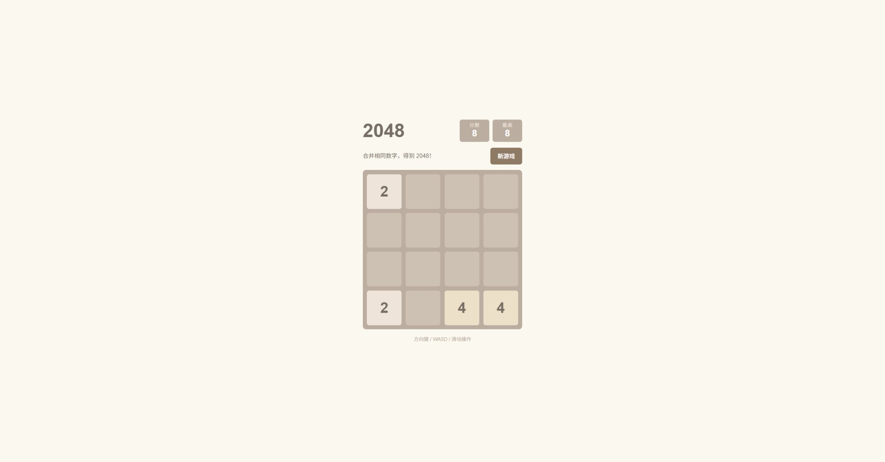
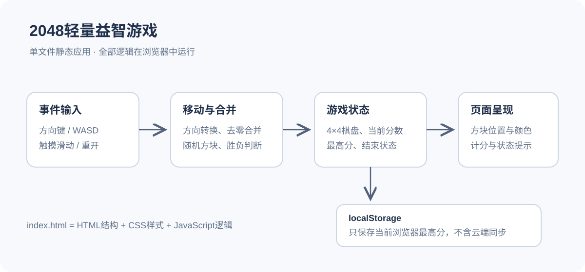

# 2048轻量益智游戏

一个用HTML、CSS和JavaScript实现的单文件2048小游戏。项目在华为云码道（CodeArts）辅助下生成，并在发布前修正了方向转换与最高分刷新问题。适合用来理解二维数组、合并规则、浏览器事件和静态网页部署。玩法参考经典2048，本项目为AI辅助实现的学习示例，并非原作者的官方版本。

## 功能与使用

下载仓库后直接用现代浏览器打开`index.html`，即可开始游戏。项目没有后端、账号系统、数据库、安装依赖或外部脚本请求；也可以通过任意静态HTTP服务器运行。

棋盘为4×4，使用方向键或WASD移动。相同数字在一次移动中相邻时合并，新产生的方块不在同一次移动里再次合并。有效移动后随机生成2或4，合并所得数字计入当前分数。支持胜利与结束提示，以及“新游戏”和“再来一局”。代码也包含触摸滑动入口，实际移动设备体验仍待补充验证。

最高分使用当前浏览器的localStorage保存，不会自动跨浏览器或跨设备同步。清除站点数据会清除最高分；当前版本不保存完整棋盘进度。

## 实现结构

整个应用在浏览器中运行。键盘或触摸事件确定方向，游戏逻辑把棋盘转换为统一方向，完成去零、相邻合并和补零，再恢复原方向。页面根据二维数组更新方块位置、分数和结束提示，最高分只写入本机浏览器存储。

例如`[2,2,4,4]`向左合并后为`[4,8,0,0]`，增加12分，随后在空格中生成一个随机数字。`[2,2,2,2]`只会合并成`[4,4,0,0]`，避免一次操作连续合并。

## 发布前验证

发布前发现初版的矩阵转换仅颠倒了行顺序，未完成旋转，现已修正。另将最高分更新放到界面渲染之前，使当前分数与最高分同步显示。

修正版已用固定棋盘验证四个移动方向、单次合并、无效移动不生成方块、计分、胜利判断与重新开始，并在桌面浏览器中使用方向键和WASD试玩。没有把HTTP响应成功作为全部游戏规则正确的证明。

## 云端实验与当前状态

初版曾用于临时沙箱和按需ECS静态部署实验，通过Nginx提供页面，并核对HTTP 200及正文内容。ECS实验资源已释放，原公网地址已失效。方向修正是在后续发布验收时完成，修正版在本地验证，没有再次创建付费ECS部署。

本仓库只保留游戏源码与展示材料，不包含云账号信息、凭据或资源记录。作品当前不依赖任何付费云服务。后续可以继续增加撤销一步、完整局面保存和移动端适配测试。
